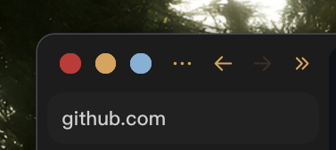
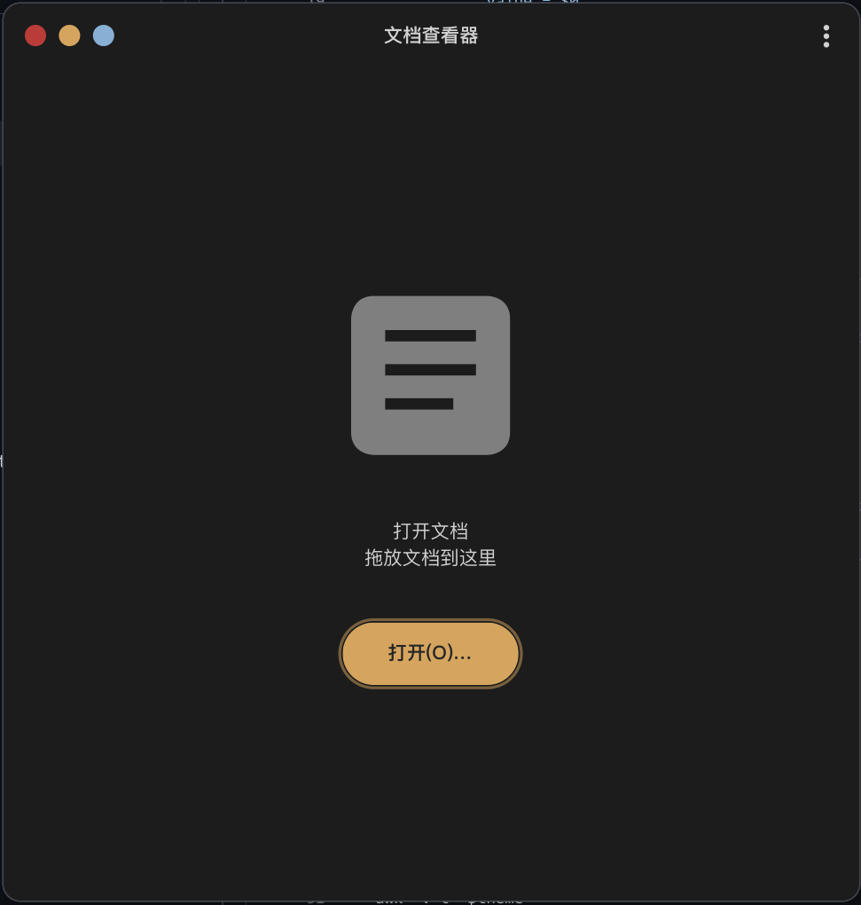
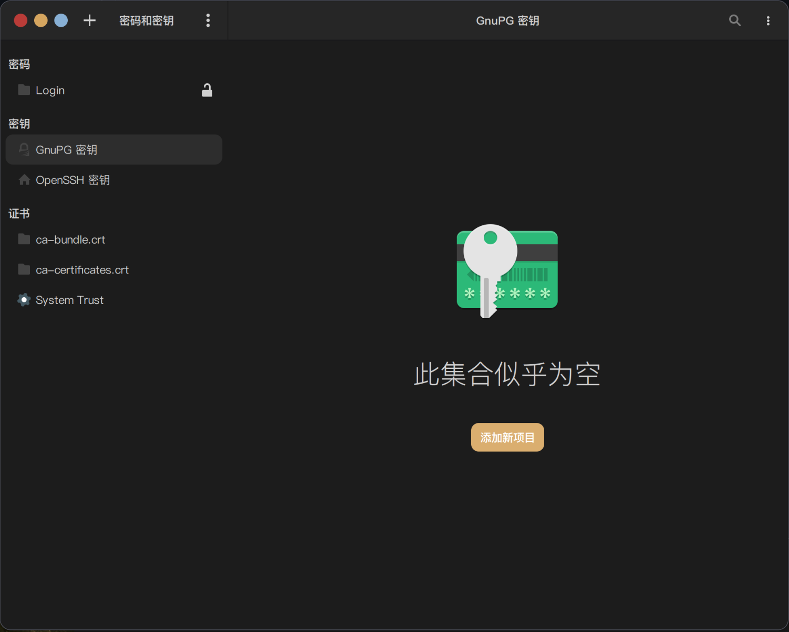

# aohg-noctalia-themes

> 本项目内容（模板、脚本、文档）由 AI 生成，仅供参考和个人使用；应用前请自行审查。

一组 Noctalia 用户模板：umbriel 风格的窗口按钮（GTK4 / GTK3 / Firefox·Zen），以及 fcitx5 的 mellow 风格配色主题。

## 截图

| Umbriel 窗口按钮 + fcitx5 | Zen Browser |
|---|---|
|  |  |
| **libadwaita（GTK4）** | **GTK3（Seahorse）** |
|  |  |

## 包含

### `templates/umbriel-gtk4/`

| 文件 | 作用 |
|---|---|
| `gtk4.css` | GTK4/libadwaita 窗口圆点按钮（圆点画在 image 上，不受标题栏拉伸影响） |
| `gtk3.css` | GTK3 窗口圆点按钮（Seahorse 等 GTK3 应用）；渲染到 `gtk-3.0/colors.css`，由 KDE 模块热重载 |
| `firefox-buttons.css` | Firefox/Zen userChrome 圆点按钮，最大化时方角 |
| `input.sh` / `input3.sh` | 读取 umbriel `config.toml`，生成 GTK4/GTK3 按钮尺寸、圆角、间距 |
| `firefox-input.sh` | 同上，供 Firefox userChrome 使用 |
| `apply.sh` | 把 GTK4 按钮 CSS `@import` 进 `gtk-4.0/gtk.css` |
| `apply-gtk3.sh` | 旧方案：把 GTK3 按钮 CSS `@import` 进 `gtk-3.0/gtk.css`；配合 KDE 模块热重载时不需要 |
| `firefox-apply.sh` | 把按钮 CSS 注入 Firefox/Zen profile 的 `userChrome.css` |

### `templates/fcitx5-mellow/`

| 文件 | 作用 |
|---|---|
| `theme.conf` | fcitx5 输入面板/菜单配色（noctalia 调色板） |
| `panel.svg` / `highlight.svg` | mellow 圆角面板与高亮，颜色跟随 noctalia |
| `apply.sh` | 写入 `classicui.conf` 启用主题；按 umbriel `corner_radius` 调整圆角 |

## 依赖

- umbriel（提供配色、`[appearance] corner_radius`、`[appearance.title_bar]` 按钮参数）

## 安装

1. 复制模板到 Noctalia 配置目录：

   ```sh
   cp -r templates/* ~/.config/noctalia/templates/
   ```

2. 把 [config.example.toml](config.example.toml) 里的 `[theme.templates.user.*]` 合并到 `~/.config/noctalia/config.toml`（NixOS / home-manager 用户请合并到 HM 生成的 config.toml）。

3. GTK3 应用要实时跟随配色，装 KDE 的 GTK3 颜色重载模块，并让 `gtk.css` 导入 `colors.css`：

   - 安装提供该模块的包（Arch: `kde-gtk-config`；NixOS: `kdePackages.kde-gtk-config`）
   - 设置 `GTK3_MODULES=<路径>/lib/gtk-3.0/modules/libcolorreload-gtk-module.so`
   - `~/.config/gtk-3.0/gtk.css` 里加 `@import url("colors.css");`

4. 重启 Noctalia 或切换一次壁纸/主题，触发模板渲染。

## GTK3 热重载

Noctalia 把 `gtk3.css` 渲染到 `~/.config/gtk-3.0/colors.css`。KDE 的 `libcolorreload-gtk-module`
（通过 `GTK3_MODULES` 加载）监听这个文件，文件一变就重载 GTK3 应用的 CSS provider，所以改配色时
已经打开的 GTK3 应用会立即变色。模块只在启动时建立监听、不会主动加载文件，因此 `gtk.css`
还需要 `@import url("colors.css");`，新启动的应用才能拿到同一份样式。

## 调参

按钮尺寸/圆角/间距来自 `~/.config/umbriel/config.toml`：

- `[appearance] corner_radius` — 窗口圆角
- `[appearance.title_bar] height` — 标题栏高度，用于推导按钮大小
- `[appearance.title_bar] button_size` — 按钮直径；`-1` 时按 umbriel 源码 `titleBarButtonDiameter()` 派生
- `[appearance.title_bar] button_gap` — 按钮间距
- `[appearance.title_bar] button_corner_radius` — 按钮圆角；`-1` 跟随窗口圆角

派生尺寸输出时下限 15px：14 补到 15，15/16 保持（GTK4、GTK3、Zen 用同一规则，尺寸一致）。fcitx5 圆角规则：`corner_radius` 为 0/1 时直角，否则使用 mellow 默认 9.5px。

## License

MIT
