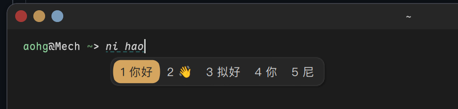

# aohg-noctalia-themes

> 本项目内容（模板、脚本、文档）由 AI 生成，仅供参考和个人使用；应用前请自行审查。

一组 Noctalia 用户模板：umbriel 风格的窗口按钮（GTK3 / GTK4 / Firefox·Zen）、Papirus 文件夹配色，以及 fcitx5 的 mellow 风格输入面板。

## 截图

| Umbriel 窗口按钮 + fcitx5 | Zen Browser |
|---|---|
|  |  |
| **libadwaita（GTK4）** | **GTK3（Seahorse）** |
|  |  |

## 包含

### `templates/umbriel-gtk/`

| 文件 | 作用 |
|---|---|
| `gtk4-buttons.css` | GTK4/libadwaita 窗口三个圆点按钮（圆点画在 image 上） |
| `gtk4-extras.css` | GTK4 圆角覆盖：列表、卡片、菜单、toggle-group、按钮 |
| `gtk3-buttons.css` | GTK3 窗口圆点按钮（Seahorse 等） |
| `gtk3-extras.css` | GTK3 圆角覆盖：按钮、行、菜单 |
| `gtk4-input.sh` / `gtk3-input.sh` | 读 umbriel `config.toml`，生成按钮尺寸/间距/圆角；extras 的圆角取自 `[appearance] corner_radius` |
| `gtk4-apply.sh` / `gtk3-apply.sh` | 把 `umbriel.css` / `umbriel-extras.css`、`colors.css` / `colors-extras.css` import 进对应 `gtk.css` |
| `firefox-buttons.css` | Firefox/Zen userChrome 圆点按钮，最大化时方角 |
| `firefox-input.sh` | 读 umbriel 配置，生成 Firefox 按钮尺寸/间距 |
| `firefox-apply.sh` | 把按钮 CSS 注入 Firefox/Zen profile 的 `userChrome.css` |

extras 只改圆角，不设置任何颜色 —— 配色由 noctalia 生成的 `noctalia.css`（`@define-color`）和 GTK 主题负责。

**只想用窗口圆点按钮**：保留 `gtk4-buttons.css` + `gtk4-input.sh` + `gtk4-apply.sh`（GTK4）或 `gtk3-buttons.css` + `gtk3-input.sh` + `gtk3-apply.sh`（GTK3），去掉 extras 对应的条目即可。

### `templates/papirus-nixos/`

| 文件 | 作用 |
|---|---|
| `colors` | 模板输入：第一行是目标色（主题 `primary`），第三行是 Papirus 固定色板表 |
| `apply.sh` | 按渲染结果给 Papirus 建薄覆盖层（只建目录骨架和 `places` 链接），用 CIEDE2000 在 Papirus 色板里挑最接近的颜色 |

需要已安装 `papirus-icon-theme`，图标主题设为 `Papirus`。脚本只接管带 `.papirus-thin-src` 标记的目录，已经存在的 Papirus 覆盖层会被跳过，不会覆盖你原来的图标。

### `templates/fcitx5-mellow/`

| 文件 | 作用 |
|---|---|
| `theme.conf` | fcitx5 输入面板/菜单配色（noctalia 调色板） |
| `panel.svg` / `highlight.svg` | mellow 圆角面板与高亮，颜色跟随 noctalia |
| `apply.sh` | 写入 `classicui.conf` 启用主题；按 umbriel `corner_radius` 调整圆角 |

## 依赖

- umbriel（提供 `[appearance] corner_radius` 和 `[appearance.title_bar]` 的按钮参数）
- 可选 `papirus-icon-theme`（只用 Papirus 模板时需要）

## 安装

1. 复制模板到 Noctalia 配置目录：

   ```sh
   cp -r templates/* ~/.config/noctalia/templates/
   ```

2. 把 [config.example.toml](config.example.toml) 里的 `[theme.templates.user.*]` 合并到 `~/.config/noctalia/config.toml`（NixOS / home-manager 用户请合并到 HM 生成的 config.toml）。

3. 重启 Noctalia 或切换一次壁纸/主题，触发模板渲染。

4. 重启 GTK 应用（GTK 不热重载用户 CSS）、重启 Firefox/Zen（userChrome 只在启动时加载）。

## GTK3 热重载

Noctalia 把 GTK3 样式渲染到 `~/.config/gtk-3.0/colors.css` 和 `colors-extras.css`。KDE 的
`libcolorreload-gtk-module`（通过 `GTK3_MODULES` 加载）监听文件变化，改配色时已经打开的 GTK3
应用会立即变色；`gtk.css` 需要 `@import url("colors.css");` 和 `@import url("colors-extras.css");`，
新启动的应用才能拿到同一份样式。

## 调参

按钮尺寸/圆角/间距来自 `~/.config/umbriel/config.toml`：

- `[appearance] corner_radius` — 窗口圆角，同时是 extras 里列表/菜单/按钮圆角的来源
- `[appearance.title_bar] height` — 标题栏高度，用于推导按钮大小
- `[appearance.title_bar] button_size` — 按钮直径；`-1` 时按 umbriel 源码 `titleBarButtonDiameter()` 派生
- `[appearance.title_bar] button_gap` — 按钮间距
- `[appearance.title_bar] button_padding` — 按钮组左侧内边距
- `[appearance.title_bar] button_corner_radius` — 按钮圆角；`-1` 跟随窗口圆角

Papirus 模板的选色：`colors` 第一行渲染成主题 `primary` 的 hex，`apply.sh` 用 CIEDE2000 在 Papirus 固定色板里找最接近的文件夹颜色。Papirus 只有固定的一批颜色，想要精确等于主题色只能自己给 SVG 重上色。

fcitx5 圆角规则：`corner_radius` 为 0/1 时直角，否则使用 mellow 默认 9.5px。

## License

MIT
